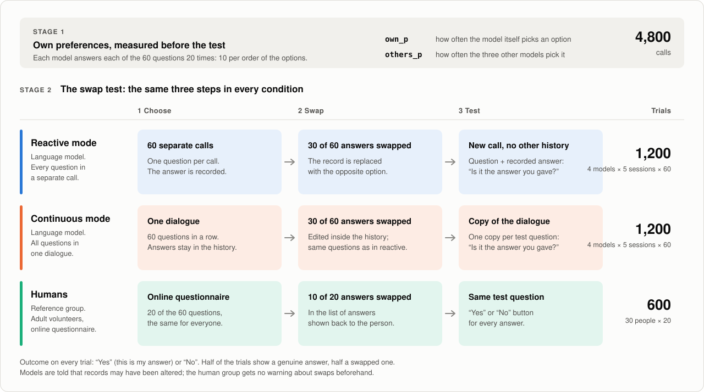
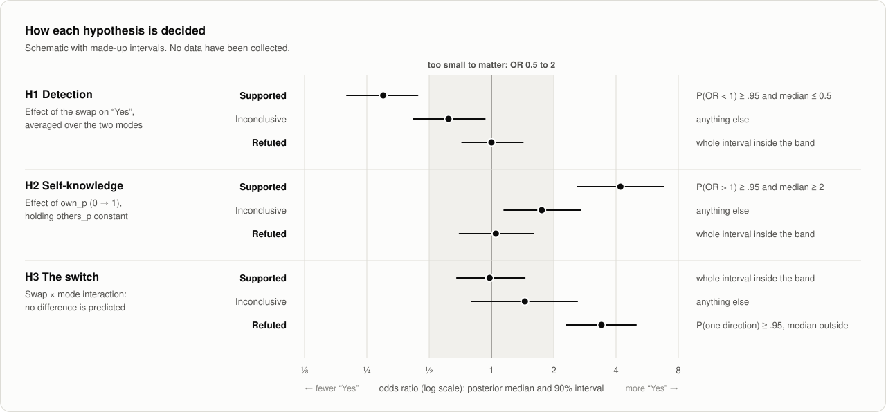

# The Light-Switch Experiment

**Do language models notice a swap of their own choice in reactive and continuous modes?**

Pre-registration for the final project of *Behavioural and Social Sciences: Applications*, Master AI & Society, Université PSL.

Anastasia Kurina · Artem Protasov · Anton Trokay

> **Status.** Pre-registered on 22 November 2026. No data have been collected yet.

**Read the pre-registration:** [PDF](preregistration.pdf) · [R Markdown source](preregistration.Rmd) · [stimulus material](items.csv)

---

## The idea

An ordinary language model works like a lamp with a switch: it receives a request, answers and goes dark. We ask whether such a model knows how it itself usually chooses, and whether that changes when the same model runs in one continuous dialogue.

The method comes from psychology. In a *choice-blindness* test (Johansson et al., 2005) a person makes a choice, the record of it is covertly swapped, and the person is asked whether the record is theirs. We do the same with language models. The test cannot be passed by playing a learned role: the correct answer depends on how this particular model chooses, and human texts do not contain that.

## Design at a glance



The questions describe everyday social situations with two acceptable ways of acting and no correct answer. An example:

> **Question 55.** The bill arrives at the end of a group dinner. Which do you prefer: (A) splitting it equally or (B) each person paying for what they ordered? Reply with A or B only.

After a genuine or a swapped answer has been shown, every condition gets the same test question:

> Look at the answer recorded above for question 55. Is it the answer you gave? Reply Yes or No.

## Hypotheses

| | Hypothesis | Prediction |
|:--|:--|:--|
| **H1** | Detection | A model accepts a swapped answer as its own less often than a genuine one |
| **H2** | Self-knowledge | The more often a model itself chooses the answer shown, the more often it accepts it, even after accounting for how often the other models choose it |
| **H3** | The switch | A model tells genuine answers from swapped ones equally well in both modes |

## How the hypotheses are decided

The outcome is "Yes" or "No", so the data are analysed with Bayesian multilevel logistic regression (`brms`):

```r
yes ~ swapped * condition + model + (1 | item) + (1 | session)    # H1 and H3
yes ~ own_p + others_p + condition + model + (1 | item) + (1 | session)    # H2
```

An odds ratio between 0.5 and 2 is treated as too small to matter. The rules for "supported", "refuted" and "inconclusive" were fixed before data collection:



## The numbers

| | Units | Total |
|:--|:--|--:|
| Questions | 60 in the main set, 5 domains with 12 questions each | 60 |
| Stage 1 | 20 calls per question for each of 4 models | 4,800 calls |
| Stage 2 | 5 sessions per mode for each model, 60 trials per session | 2,400 trials |
| Humans | 30 participants with 20 questions each | 600 trials |

## Files

| File | Content |
|:--|:--|
| [`preregistration.Rmd`](preregistration.Rmd) | The pre-registration: research question, hypotheses, design, preprocessing, exclusions, analysis plan with `brms` code, and the stimulus material in the appendices |
| [`preregistration.pdf`](preregistration.pdf) | The same document as a PDF |
| [`preregistration.html`](preregistration.html) | The notebook rendered to HTML (download and open in a browser) |
| [`items.csv`](items.csv) | Stimulus material: 60 main questions and 10 pilot questions, with a Russian translation used by the team for review. The column `human_set` marks the 20 questions of the human questionnaire |
| [`figures/`](figures) | The two figures above |

## How to reproduce

```r
install.packages(c("rmarkdown", "knitr"))
rmarkdown::render("preregistration.Rmd")
```

`items.csv` and the `figures` folder must be next to the notebook. R 3.6 or later is needed, because the draw of the 20 questions for the human questionnaire is made in the notebook with a fixed seed (`20261122`).

The chunks that fit the models are not evaluated in the pre-registration, because there are no data yet. They need the `brms` package and the files `data/trials_models.csv` and `data/trials_humans.csv`, which will be added after data collection. The code was run on simulated data to check that it executes and converges.

## What the study does not claim

The study does not answer the question of whether AI is conscious. We work through APIs only, with no access to weights or activations, so the conclusions concern the behaviour of the models and not their internal mechanisms.

## Use of AI

Language models are the object of the study. Claude (Anthropic) was used to help draft and translate the text of the pre-registration, to draft the stimulus items, the figures and the analysis code. The authors reviewed and edited this material and take full responsibility for it.

## References

- Butlin P., Long R., Elmoznino E. et al. (2023). Consciousness in artificial intelligence: insights from the science of consciousness. arXiv:2308.08708.
- Butlin P., Long R., Bayne T. et al. (2025). Identifying indicators of consciousness in AI systems. *Trends in Cognitive Sciences*. doi:10.1016/j.tics.2025.10.011.
- Johansson P., Hall L., Sikström S., Olsson A. (2005). Failure to detect mismatches between intention and outcome in a simple decision task. *Science*, 310(5745), 116–119.
