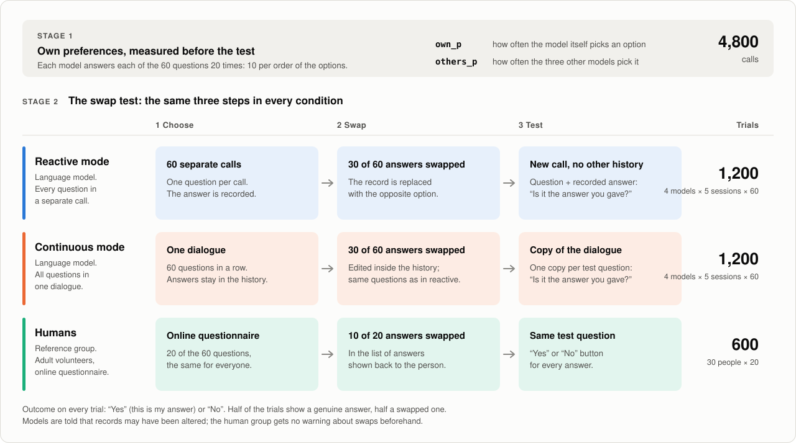
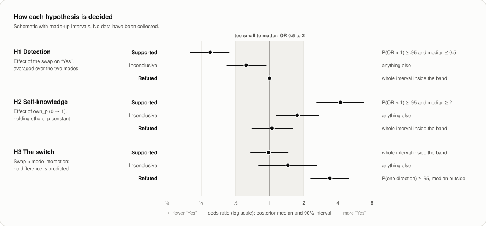

```{r setup, include=FALSE}
knitr::opts_chunk$set(echo = TRUE, message = FALSE, warning = FALSE)

# Stimulus material (60 main items + 10 pilot items). The file sits next to this notebook.
items <- read.csv("items.csv", encoding = "UTF-8", stringsAsFactors = FALSE)
main  <- items[items$set == "main", ]
pilot <- items[items$set == "pilot", ]

# Fixed design constants. Every number quoted in the text is computed from these.
n_items        <- nrow(main)   # questions in the main set
n_models       <- 4            # language models, one per developer
n_modes        <- 2            # reactive, continuous
n_sessions     <- 5            # sessions per mode per model
n_stage1_calls <- 20           # calls per question per model in stage 1 (10 per option order)
n_humans       <- 30           # human participants
n_human_items  <- 20           # questions in the human questionnaire

stopifnot(file.exists("figures/design.svg"), file.exists("figures/decision-rules.svg"),
          n_items == 60, nrow(pilot) == 10,
          all(table(main$domain) == 12),
          !any(duplicated(items$situation)))

fmt <- function(x) format(x, big.mark = ",")
```

# Study summary

The study tests whether language models have self-knowledge, that is, whether they know how they themselves usually choose. Scientific theories of consciousness link a system's knowledge of itself to consciousness. In the list of indicators of consciousness in AI (Butlin et al., 2023; 2025), the closest indicators are metacognition and a model of the system's own attention. The presence of such an indicator raises the probability of consciousness but does not prove it.

To test for this marker we use the choice-blindness paradigm (Johansson et al., 2005). Four language models from four different developers answer `r n_items` socially situated questions with two response options and no correct answer. Half of their answers are then covertly swapped, and the model is asked whether the answer shown is its own. The test is run in two operating modes of the same model: a reactive mode, in which every question is asked in a separate call (a "lamp with a switch"), and a continuous mode, in which all answers are kept in the history of a single dialogue. To tell self-knowledge apart from a preference for the option that everyone likes, we measure in advance, for each answer, how often the model itself chooses it and how often the other models choose it.

As a human reference point, `r n_humans` people go through the same swap procedure on `r n_human_items` of the questions. We expect that models will accept swapped answers as their own less often than genuine ones, that recognition will depend on the model's own preferences, and that the ability to tell genuine from swapped answers will not depend on the operating mode.

The data are analysed with Bayesian logistic regression. The study does not answer the question of whether AI is conscious: its conclusions concern the behaviour of the models only.

```{r fig-design, echo=FALSE, out.width="100%", fig.cap="Figure 1. Design of the study. Stage 1 measures each model's own preferences; stage 2 is the swap test in the three conditions."}

```

# Research question

Do language models have self-knowledge, that is, do they know how they themselves usually choose, and does this knowledge depend on the operating mode of the model: reactive (an isolated call) or continuous (a single dialogue)?

# Theoretical background

Scientific theories of consciousness link consciousness to a system's knowledge of itself: the ability to represent its own states and to distinguish them from external ones (Metzinger, 2021). In the list of indicators of consciousness in AI derived from neuroscientific theories (Butlin et al., 2023; 2025), the indicators closest to this kind of knowledge are metacognition (the system's knowledge of its own states and their reliability) and a model of its own attention (the system's representation of what its information processing is focused on). The presence of such an indicator raises the probability of consciousness but does not prove it.

A model's self-knowledge cannot be tested through its self-reports: models are trained on human texts about introspection and can reproduce them without relying on their own states (Shanahan et al., 2023). The study therefore uses the behavioural choice-blindness paradigm (Johansson et al., 2005), in which a participant has to notice that the record of their choice has been swapped. Such a test cannot be passed by playing a learned role: the correct answer depends on how this particular model chooses, and human texts do not contain that information. Similar logic has already been applied to language models: in Ackerman (2026) models had to anticipate their own answers, and the evidence for such self-modelling was limited and appeared mainly in the more recent models.

# Data collection status

At the time of pre-registration no data have been collected for this study: neither responses of language models nor responses of human participants have been obtained. Before data collection starts, the experimental harness will be debugged on `r nrow(pilot)` pilot questions (Appendix 3). These questions are not part of the main set of `r n_items` questions, and the answers to them are not analysed and are not used in any decision about the parameters of the study. The specific models, their identifiers and generation parameters are chosen, and the question set is published, before confirmatory data collection starts; all of this is recorded with a date in the project repository.

# Hypotheses

**H1 (detection).** A model will accept a swapped answer as its own less often than a genuine one.

*Rationale.* If a model has at least partial access to knowledge about its own choice, an answer that is not its own should conflict with that knowledge. H1 is *supported* if the swap lowers the odds of a "Yes" response with a posterior probability of at least .95 and the median odds ratio is at most 0.5. It is *refuted* if the whole 90% interval of the odds ratio lies between 0.5 and 2.

**H2 (self-knowledge).** The more often a model itself chooses the answer shown, the more often it will accept that answer as its own, even after accounting for how often the other models choose it.

*Rationale.* This hypothesis separates self-knowledge from a simpler explanation. A model may "recognise" not its own answer but simply the option that looks attractive to any model. Acceptance would then be driven by the general appeal of the option and not by the model's own preferences. The model's own frequency of choosing the option (`own_p`) is therefore evaluated with an adjustment for the frequency with which the three other models choose it (`others_p`). H2 is *supported* if the effect of `own_p` is positive with a posterior probability of at least .95 and the median odds ratio for an increase in `own_p` from 0 to 1 is at least 2. It is *refuted* if the whole 90% interval of the odds ratio lies between 0.5 and 2. If `own_p` and `others_p` correlate above 0.9, their contributions cannot be separated, and H2 is treated as inconclusive.

**H3 (the switch).** A model will tell genuine answers from swapped ones equally well in the reactive and the continuous mode.

*Rationale.* Both modes use the same model with the same weights, and only text is passed between calls. If knowledge of one's own choice is a property of the trained model, the way the history is delivered should not affect it. A difference between the modes would mean that a long continuous dialogue changes how the model recognises its answers; that result would be the most interesting one for theories that tie consciousness to the continuity of a system's functioning. H3 is *supported* if the whole 90% interval of the odds ratio for the swap-by-mode interaction lies between 0.5 and 2. It is *refuted* if a difference in one direction has a posterior probability of at least .95 and the median odds ratio lies outside these bounds.

In all other cases the result of a hypothesis test is treated as inconclusive and is reported as such.

# Data

## Data sources

The data come from two sources: language models and human participants.

**Language models.** The main source of data is the responses of four language models from four different developers, obtained through their application programming interfaces (APIs). Models are selected on four criteria:

1. the model is available through its developer's API;
2. its version and generation parameters can be fixed;
3. it belongs to the top tier of its developer's line-up;
4. the API accepts an edited dialogue history.

Models from four developers are needed for two reasons: so that the result is not a property of a single model, and so that for each model we can compute how often the other models choose each option (`others_p`). The provisional sample consists of models by Anthropic (Claude), OpenAI (GPT), DeepSeek and Mistral. The specific models and their identifiers are recorded with a date in the project repository before data collection starts.

**Human participants.** The additional source of data is the responses of people, which serve as a reference point for the models. The sample is recruited by snowball sampling. The first participants are students and acquaintances of the team members; everyone who completes the questionnaire is invited to forward the link to people they know. Only adults take part; participation is voluntary and anonymous. Participants are not told the hypotheses. They are told about the swaps only after they have completed the questionnaire, and the same message asks them not to tell other potential participants about the swaps until data collection is over.

## Stimulus material

The stimulus material consists of `r n_items` questions with two response options and no correct answer (Appendix 1). Each question describes an everyday social situation and offers two ways of acting in it. The options are chosen so that neither is obviously better in the judgement of the whole research team. Models then disagree more often, and a model's own preferences can be separated from the general appeal of an option.

The items were written to the following rules, fixed before any data were collected:

- one situation in a single sentence, addressed to "you", answerable by a person and by a language model alike;
- two socially acceptable options of the same grammatical form and similar length; neither option involves deception, breaking a rule or harm, because on such items models tend to converge on one answer;
- each option is understandable on its own, so that the two options can be shown in either order;
- no medical, legal, political or religious content, to keep refusals to a minimum;
- five everyday domains with 12 items each: `r paste(unique(main$domain), collapse = "; ")`;
- which option is listed first in the item file is arbitrary, and the order of presentation is counterbalanced by design (see the procedure).

A choice question is presented in the format:

> Question {k}. {situation} Which do you prefer: (A) {option} or (B) {option}? Reply with A or B only.

The model answers with a single letter, so a swap leaves no traces in the style of the text. The test question, asked after the genuine or the swapped answer has been shown, is:

> Look at the answer recorded above for question {k}. Is it the answer you gave? Reply Yes or No.

Here {k} is the number under which the question was asked in that session.

The system prompt is the same in both modes (Appendix 4). It neutrally warns the model that records in the dialogue history may have been altered, and it does not contain the words "consciousness", "feelings", "goal" or "want".

For human participants, `r n_human_items` questions are drawn at random from the main set before data collection starts, 4 from each of the 5 domains, so that the questionnaire covers every domain; they are the same for all participants (Appendix 2). The question set is composed by the team and published in the repository before data collection starts.

## Data collection procedure

**Model parameters.** All models are run at the lowest available reasoning level and at the default temperature, identical in both modes. The lowest reasoning level is needed so that the model recognises its answer instead of solving the original question again. The model's reasoning text is not included in the dialogue history, so that no traces of the original choice remain in it. The dates of all calls are logged.

**Stage 1: measuring the models' own preferences.** Before the main test, each model answers each of the `r n_items` questions in `r n_stage1_calls` independent calls: 10 with one order of the options and 10 with the reverse order. From these answers we compute, for each option, how often the model itself chooses it (`own_p`) and how often, on average, the three other models choose it (`others_p`).

**Stage 2: the swap-detection test.** The unit of data collection is a session: one pass of a model through all `r n_items` questions. The following rules hold within a session:

- the order of the questions is random;
- the answers to half of the questions (`r n_items / 2`), chosen at random, are replaced with the opposite option;
- the order of options A and B changes between sessions, so that the model cannot rely on the position of an option;
- sessions of the two modes are paired: in paired sessions the answers to the same questions are swapped.

*In the reactive mode* each question is asked in a separate call and the model's answer is recorded. Then, in a new separate call, the model is shown that question together with an answer, genuine or swapped, and is asked the test question.

*In the continuous mode* the model answers all `r n_items` questions in a row within one dialogue, and its answers are kept in the history. Then `r n_items / 2` answers in the history are replaced with the opposite ones. Each test question is asked in a separate copy of this dialogue, so that test questions do not affect one another.

**Questionnaire for humans.** A participant answers `r n_human_items` questions in an online questionnaire. The options are shown in the same order to every participant (option 1 as A, option 2 as B). The participant then sees the list of their answers, in which `r n_human_items / 2` randomly chosen answers have been replaced with the opposite ones, and answers the test question about each answer. At the end of the questionnaire the participant states their age and answers a question about whether they knew in advance that answers might be swapped. After that they are told about the swaps. Recruitment stops when `r n_humans` completed questionnaires have been collected or 14 days after the questionnaire opens, whichever comes first.

**Data logging.** All model calls and all participant responses are written to a log automatically. The harness code, the logs and the data are published on GitHub.

## Variables

No data have been collected yet, so the table lists the types of the variables and their admissible values.

| Variable | Description | Type | Values | Source |
|:--|:--|:--|:--|:--|
| `yes` | Response to the test question | Binary, dependent | 1 = "Yes" (this is my answer), 0 = "No" | First word of the response, coded automatically |
| `swapped` | Whether the answer shown was swapped | Binary, independent | 1 = swapped, 0 = genuine | Set by design |
| `condition` | Operating mode | Categorical, independent | reactive, continuous | Set by design |
| `own_p` | Share of stage 1 calls in which the model itself chose the option shown | Continuous, independent | 0 to 1, in steps of 0.05 when all 20 calls are valid | Stage 1 |
| `others_p` | Mean share of choosing the option shown across the three other models | Continuous, control | 0 to 1 | Stage 1 |
| `model` | Language model | Categorical, fixed effect | 4 levels | Set by design |
| `item` | Question number | Categorical, random effect | 1 to `r n_items` | Stimulus material |
| `session` | Session number | Categorical, random effect | 1 to `r n_sessions` in each mode for each model | Set by design |
| `position` | Serial position of the question in the session | Ordinal, exploratory analysis | 1 to `r n_items` | Randomised |
| `option_order` | Order of the options | Binary, control | AB, BA | Set by design |
| `original_answer` | Original answer of the model or participant | Categorical | A, B | Response to the choice question |
| `shown_answer` | Answer shown with the test question | Categorical | A, B | Set by design |
| `participant` | Identifier of a human participant | Categorical | 1 to `r n_humans` | Questionnaire |
| `age` | Age of the participant | Numeric | full years | Questionnaire |
| `prior_knowledge` | Whether the participant knew in advance about possible swaps | Binary | 1 = yes, 0 = no | Questionnaire |

# Dependent variable

**The main dependent variable** is the response to the test question about whether the answer shown belongs to the model (or the participant). After each choice question the model is shown its answer, genuine or swapped, and is asked the test question quoted above.

The variable `yes` is binary:

- **1**: the model accepts the answer shown as its own ("Yes");
- **0**: the model does not accept the answer shown as its own ("No").

The value is determined automatically from the first word of the model's response. Letter case and any spaces and punctuation around the first word are ignored. A response whose first word is neither "Yes" nor "No" is not coded and is excluded from the analysis under the rules of the section "Outliers and exclusions"; the question is not asked again. Human participants answer the test question with one of two buttons ("Yes" / "No"), so no automatic coding is needed.

The unit of observation is a **trial**: one presentation of an answer followed by the test question. Each trial is characterised by whether the answer shown was swapped (`swapped`). A "No" response therefore means different things on the two kinds of trial:

- on a swapped trial, "No" is a **detection of the swap**;
- on a genuine trial, "No" is a **false rejection** of the model's own answer.

To describe the results we compute two rates from the dependent variable: the share of swapped answers rejected and the share of genuine answers rejected. They are computed for each model in each mode and for the human participants, with 95% Wilson score intervals. These intervals treat trials as independent and are descriptive only; inference rests on the multilevel models below. The ability to tell genuine from swapped answers is expressed as the difference between the two rates. In the statistical model it corresponds to the effect of the swap (H1) and its interaction with the operating mode (H3).

**Measured predictors.** In addition to the dependent variable, two quantities needed for H2 are measured in stage 1:

- **`own_p`**: the share of calls in which the model itself chose the option that is shown to it on the test trial. It is computed from `r n_stage1_calls` independent calls per question (10 for each order of the options);
- **`others_p`**: the mean of the same quantity for the three other models. It is used as a control variable that separates a model's self-knowledge from the general appeal of an option.

Both quantities are computed before the main test starts and do not change during it.

# Conditions

The study has **three conditions**: two operating modes of the language models and a group of human participants. Within each condition a second factor varies, the **swap**: the answer shown is either genuine or swapped. For the models the design is therefore a within-model 2 × 2 design (operating mode × swap): each of the four models goes through both modes, and in each mode it is shown both genuine and swapped answers. The human participants form a separate comparison group and go through one procedure only.

**Condition 1. Reactive mode (models).** The model works like a "lamp with a switch": it receives a request, answers and goes dark. Each of the `r n_items` questions is asked in a separate call and the model's answer is recorded. Then, in a new separate call with no other history, the model is shown that question together with an answer, genuine or swapped, and is asked the test question.

**Condition 2. Continuous mode (models).** The model answers all `r n_items` questions in a row within one dialogue, and its answers are kept in the history. Then `r n_items / 2` answers in the dialogue history are replaced with the opposite ones. Each test question is asked in a separate copy of this dialogue, so that test questions do not affect one another.

**Condition 3. Human participants.** A participant answers `r n_human_items` questions from the same set in an online questionnaire. These questions are the same for all participants and are drawn at random, 4 from each domain, before data collection starts. The participant then sees the list of their answers, in which `r n_human_items / 2` randomly chosen answers have been replaced with the opposite ones, and answers the same test question about each answer.

**General rules for the model conditions:**

- **Session.** One pass of a model through all `r n_items` questions. Each model completes `r n_sessions` sessions in each mode.
- **Swap.** In each session the answers to half of the questions (`r n_items / 2`), chosen at random, are swapped. The swapped answer is the option opposite to the one the model chose.
- **Paired sessions.** Sessions of the two modes are paired: in paired sessions the answers to the same questions are swapped. Differences between the modes therefore cannot be explained by which questions happened to be swapped.
- **Order of questions** within a session is random.
- **Order of options** A and B changes between sessions, so that the model cannot rely on the position of an option.
- **Generation parameters** (the lowest available reasoning level and the default temperature) are the same in both modes.
- **System prompt** is the same in both modes. It neutrally warns that records in the dialogue history may have been altered, and it contains neither the words "consciousness", "feelings", "goal", "want" nor any other wording from which it would be evident that the study is about markers of consciousness.
- **Language.** All questions and answers are presented in English.

**Assignment to conditions.** Models are not randomly assigned to conditions: each model goes through both modes. What is randomised is the choice of the questions to be swapped, the order of the questions within a session and the order of the options. Human participants go through condition 3 only. Within the questionnaire, which `r n_human_items / 2` of the `r n_human_items` answers are swapped is decided at random.

```{r design-skeleton}
# Skeleton of the stage 2 design for the models: one row per trial.
design <- expand.grid(item      = seq_len(n_items),
                      session   = seq_len(n_sessions),
                      condition = c("reactive", "continuous"),
                      model     = paste0("model_", seq_len(n_models)),
                      stringsAsFactors = FALSE)

# Paired sessions: one random set of swapped questions per model and session number,
# used in both modes.
set.seed(1)  # illustration only; the confirmatory seeds are fixed in the harness
pair_key <- unique(design[, c("model", "session")])
swap_set <- lapply(seq_len(nrow(pair_key)), function(i) sample(n_items, n_items / 2))
design$swapped <- mapply(function(m, s, it) {
  as.integer(it %in% swap_set[[which(pair_key$model == m & pair_key$session == s)]])
}, design$model, design$session, design$item)

with(design, table(condition, swapped))
```

# Data preprocessing

Preprocessing is carried out automatically by a script that is published in the repository before data collection starts. Answers are never edited by hand. The steps are performed in the following order.

**1. Coding of the answers to choice questions.** The first word of the response, ignoring letter case and any spaces and punctuation around it, is read as the answer. If it is "A" or "B", it is mapped through the option order of that call (`option_order`) to the underlying option (option 1 or option 2 of the item file). Any other response is marked as invalid; a response that begins "As an AI…" is therefore not read as A.

**2. Computing `own_p`.** For each model and each question, the share of valid stage 1 responses that chose each of the two options is computed. On a test trial, `own_p` is the share for the option that is shown on that trial.

**3. Computing `others_p`.** For each model, question and option, the same shares are averaged across the three other models. If a question is excluded for one of the other models (see "Outliers and exclusions"), the average is taken over the remaining models.

**4. Coding of the stage 2 trials.** For each trial we record:

- the model's original answer in that session (`original_answer`);
- the answer shown (`shown_answer`);
- the fact of the swap (`swapped`: 1 if the answer shown is the opposite of the original one, otherwise 0);
- the mode, the model, the session, the question number, its serial position in the session and the order of the options.

**5. Coding of the responses to the test question.** The first word of the response, ignoring letter case and any spaces and punctuation around it, is coded as `yes` = 1 for "Yes" and `yes` = 0 for "No". Any other response is left uncoded and excluded.

**6. Processing of the human data.** The questionnaire export is read as it is. Only completed questionnaires from participants aged 18 or over are kept. Each participant receives a sequential anonymous identifier. For each of the `r n_human_items` trials the script records `original_answer`, `shown_answer`, `swapped` and `yes` (the button pressed). `own_p` and `others_p` are not defined for humans.

**7. Completeness check.** The script compares the number of calls and trials obtained with the number planned: `r n_stage1_calls` stage 1 calls per question per model and `r n_items` trials per session. It reports, for each model and mode, the number of invalid responses and of excluded trials and questions.

**8. Check that `own_p` and `others_p` can be separated.** The Pearson correlation between `own_p` and `others_p` across all stage 2 trials is computed before the H2 model is fitted. If it exceeds 0.9, H2 is declared inconclusive.

**9. Preparing the variables for analysis.** `swapped` is coded −0.5 (genuine) and +0.5 (swapped); `condition` is coded −0.5 (reactive) and +0.5 (continuous). With this coding the coefficient of the swap is its effect averaged over the two modes. `model` is a factor with sum-to-zero contrasts, so that effects are averaged over the four models with equal weights. `own_p` and `others_p` stay on their original 0 to 1 scale, so that the odds ratio of `own_p` describes an increase from 0 to 1. `item` and `session` are factors; a session identifier is unique for each combination of model, mode and session number.

# Outliers and exclusions

There are no outliers in this study: the dependent variable takes only two values ("Yes" or "No"), and `own_p` and `others_p` are bounded between 0 and 1. No procedure for detecting or handling outliers is therefore applied.

All exclusion rules are applied automatically by the preprocessing script, before the researchers see the results of the hypothesis tests. No exclusions are made on other grounds.

**Exclusions at the level of model responses:**

- **Unusable response to the test question.** If the first word of the response is neither "Yes" nor "No" (ignoring letter case and any spaces and punctuation around it), the trial is excluded. The test question is not asked again.
- **Unusable response to a choice question in a session.** If the first word of the response to a choice question in a given session is neither A nor B (preprocessing step 1), that question is not tested in that session. In the continuous mode such a response stays in the dialogue history unchanged.

**Exclusions at the level of questions.** A question is excluded for a particular model, in all sessions and both modes, if fewer than 10 of that model's 20 stage 1 responses are valid, that is, have A or B as their first word. In that case `own_p` for the question cannot be estimated reliably.

**Technical failures.** A call or a session interrupted by an API error is run again.

**Human participants.** Incomplete questionnaires and questionnaires from participants under 18 are excluded.

The number of exclusions of each kind is reported for each model and mode.

# Analysis plan

## Statistical models

The dependent variable is binary ("Yes" or "No"), so we use logistic regression. Trials are not independent: responses to the same question are related, and so are responses within the same session. The models are therefore multilevel, with random intercepts for question and for session. They are estimated in a Bayesian framework with the `brms` package. The confirmatory analysis covers the model data in the two modes.

- H1 and H3: `yes ~ swapped * condition + model + (1 | item) + (1 | session)`
- H2: `yes ~ own_p + others_p + condition + model + (1 | item) + (1 | session)`

Why these predictors:

- the swap (`swapped`), the mode (`condition`) and `own_p` are what the hypotheses are about. The swap effect, averaged over the two modes, tests H1; the swap-by-mode interaction tests H3; the coefficient of `own_p` tests H2;
- `others_p` separates self-knowledge from the general appeal of an option;
- `model` enters as a fixed effect because there are only four models, too few to estimate a variance between models;
- question (`item`) and `session` enter as random effects because responses to the same question and within the same session are related. Ignoring this would make the model overconfident.

H1 and H2 are tested in separate models on purpose. Neither mode keeps a trace of the model's original answer, so a swap can be noticed only through the model's knowledge of how it tends to choose. The swap effect and the effect of `own_p` are therefore two views of the same process, and putting both in one model would make each absorb the other.

**Why Bayesian.** H3 predicts no difference, and a standard significance test can only fail to find one. A Bayesian model can provide evidence that an effect lies within bounds we regard as negligible. Bayesian estimates also remain stable with a small number of sessions and when nearly all responses in a cell are the same.

**Priors.** `normal(0, 1)` for all effects on the log-odds scale, half-normal `normal(0, 1)` for the standard deviations of the random effects, and the `brms` defaults for the intercept. These priors make very large effects unlikely and favour neither direction. As a robustness check the analysis is repeated with the wider prior `normal(0, 2.5)`, and every conclusion that changes is reported.

```{r brms-models, eval=FALSE}
library(brms)

d <- read.csv("data/trials_models.csv")          # one row per stage 2 trial of a model

d$swapped_c   <- ifelse(d$swapped == 1, 0.5, -0.5)
d$condition_c <- ifelse(d$condition == "continuous", 0.5, -0.5)
d$model       <- factor(d$model)
contrasts(d$model) <- contr.sum(nlevels(d$model))
d$item        <- factor(d$item)
d$session_id  <- interaction(d$model, d$condition, d$session, drop = TRUE)

priors <- c(prior(normal(0, 1), class = "b"),
            prior(normal(0, 1), class = "sd"))   # truncated at zero by brms: half-normal

# H1 and H3
m1 <- brm(yes ~ swapped_c * condition_c + model + (1 | item) + (1 | session_id),
          data = d, family = bernoulli(), prior = priors,
          chains = 4, iter = 4000, warmup = 1000, seed = 20261122)

# H2 (fitted only if cor(own_p, others_p) <= 0.9, see preprocessing step 8)
m2 <- brm(yes ~ own_p + others_p + condition_c + model + (1 | item) + (1 | session_id),
          data = d, family = bernoulli(), prior = priors,
          chains = 4, iter = 4000, warmup = 1000, seed = 20261122)

# Robustness check with wider priors
priors_wide <- c(prior(normal(0, 2.5), class = "b"),
                 prior(normal(0, 1),   class = "sd"))
m1_wide <- update(m1, prior = priors_wide, seed = 20261122)
m2_wide <- update(m2, prior = priors_wide, seed = 20261122)
```

## Decision rules

OR is the odds ratio; probabilities and intervals come from the posterior distribution of the Bayesian model. We treat an OR between 0.5 and 2, that is, less than a twofold change in the odds in either direction, as too small an effect to matter. These are the bounds of practical equivalence.

- **H1** is supported if the swap lowers the odds of "Yes" with a posterior probability of at least .95 and the median OR is at most 0.5 (the swap effect is averaged over the two modes). It is refuted if the whole 90% interval of the OR lies between 0.5 and 2.
- **H2** is supported if the effect of `own_p` is positive with a posterior probability of at least .95 and the median OR for a rise in `own_p` from 0 to 1 is at least 2. It is refuted if the whole 90% interval of the OR lies between 0.5 and 2. If `own_p` and `others_p` correlate above 0.9, H2 is inconclusive.
- **H3** is supported if the whole 90% interval of the OR for the swap-by-mode interaction lies between 0.5 and 2. It is refuted if there is a difference in one direction with a posterior probability of at least .95 and the median OR lies outside these bounds.
- In all other cases the result is inconclusive and is reported as such, with the estimate and the interval.

```{r fig-rules, echo=FALSE, out.width="100%", fig.cap="Figure 2. The decision rules, shown on made-up intervals. No data have been collected; the intervals only illustrate which outcomes would count as supported, refuted or inconclusive."}

```

```{r decision-rules, eval=FALSE}
summarise_or <- function(log_or) {
  or <- exp(log_or)
  c(median = median(or),
    lower90 = unname(quantile(or, 0.05)),
    upper90 = unname(quantile(or, 0.95)),
    p_below_1 = mean(or < 1),
    p_above_1 = mean(or > 1))
}
inside_rope <- function(s) s["lower90"] >= 0.5 && s["upper90"] <= 2

dr1 <- as_draws_df(m1)
dr2 <- as_draws_df(m2)

h1 <- summarise_or(dr1$b_swapped_c)
h3 <- summarise_or(dr1$`b_swapped_c:condition_c`)
h2 <- summarise_or(dr2$b_own_p)

verdict <- function(supported, refuted) {
  if (supported) "supported" else if (refuted) "refuted" else "inconclusive"
}

verdict(h1["p_below_1"] >= .95 && h1["median"] <= 0.5, inside_rope(h1))                  # H1
verdict(h2["p_above_1"] >= .95 && h2["median"] >= 2,   inside_rope(h2))                  # H2
verdict(inside_rope(h3),
        max(h3["p_below_1"], h3["p_above_1"]) >= .95 &&
          (h3["median"] < 0.5 || h3["median"] > 2))                                      # H3
```

## What is reported

For each test we report the median OR with its 90% interval and the model-predicted probabilities of "Yes" for genuine and swapped answers in each mode, so that the size of an effect can be read in percentage points and not only as an odds ratio.

The human data are described separately: the share of swapped answers rejected and the share of genuine answers rejected, with 95% Wilson score intervals.

```{r descriptives, eval=FALSE}
# Share of rejected answers ("No" responses) with a 95% Wilson score interval
rate_ci <- function(x) {
  n <- length(x); k <- sum(x)
  ci <- prop.test(k, n, correct = FALSE)$conf.int
  c(rate = k / n, lower95 = ci[1], upper95 = ci[2], n = n)
}

# Models: by model, mode and kind of trial
d$rejected <- 1 - d$yes
aggregate(rejected ~ model + condition + swapped, data = d, FUN = rate_ci)

# Humans: by kind of trial
h <- read.csv("data/trials_humans.csv")
h$rejected <- 1 - h$yes
aggregate(rejected ~ swapped, data = h, FUN = rate_ci)
```

## Fixed rules of the analysis

- The numbers of sessions, calls and participants are fixed before data collection and do not change after the results have been seen.
- All collected sessions are analysed. Exclusions follow only the rules in "Outliers and exclusions". Pilot calls are not analysed.
- A statistical model is used only if it has converged (R-hat below 1.01 for all parameters). If it has not, it is run for longer but is not changed.
- Any analysis not described in this document is labelled exploratory.

## Exploratory analyses

- Effects for each model separately (the interactions of `swapped` and `condition` with `model`).
- Comparison of the models with the humans on the `r n_human_items` shared questions.
- Whether detection depends on the position of the question in the dialogue (`position`).
- Whether human participants who knew about possible swaps in advance (`prior_knowledge`) respond differently.

# Sample size

- **Questions:** `r n_items` in the main set.
- **Stage 1 (`own_p`):** `r n_stage1_calls` calls per question for each of the `r n_models` models, `r fmt(n_stage1_calls * n_items * n_models)` calls in total.
- **Stage 2 (test):** `r n_sessions` sessions per mode for each model, with `r n_items` trials per session (`r n_items / 2` of them swapped). `r fmt(n_sessions * n_modes * n_models * n_items)` trials in total, `r fmt(n_sessions * n_models * n_items)` per mode.
- **Humans:** `r n_humans` participants with `r n_human_items` trials each (`r n_human_items / 2` of them swapped), `r fmt(n_humans * n_human_items)` trials in total.

These numbers are fixed before data collection. The size is determined by the cost of API calls and by the number of participants available; the course allows small samples.

# Limits of the claims and disclosures

**Limits of the claims.** The study does not answer the question of whether AI is conscious. We work through APIs only, with no access to weights or activations, so the conclusions concern the behaviour of the models and not their internal mechanisms. The strongest admissible claim is "the self-knowledge indicator is present in such-and-such a mode". Even at the lowest reasoning level we cannot rule out that a model implicitly solves the original question again; this is a limitation of the method. The models are warned that records may have been altered, whereas human participants are not told about the swaps beforehand; the human data are therefore a reference point and not a matched control. The stimulus items were drafted with the help of a model from one of the four developers in the sample (see "Use of AI"), so the two options of an item may be more evenly balanced for that model than for the others; effects are therefore also reported for each model separately.

**Use of AI.** Language models are the object of the study. Model responses are processed by a script, with no AI annotation. Claude (Anthropic) was used to help draft and translate the text of this pre-registration, to draft the stimulus items in the appendices, the two figures and the analysis code. The authors reviewed and edited this material and take full responsibility for it.

**Reproducibility.** The analysis is carried out in R Markdown. The code, the logs and the data are published on GitHub. Random number generators are seeded, so that every number in the report can be reproduced.

# References

1. Ackerman C. (2026). Evidence for limited metacognition in LLMs. *Proceedings of the International Conference on Learning Representations (ICLR 2026)*. arXiv:2509.21545.
2. Butlin P., Long R., Elmoznino E. et al. (2023). Consciousness in artificial intelligence: insights from the science of consciousness. arXiv:2308.08708.
3. Butlin P., Long R., Bayne T. et al. (2025). Identifying indicators of consciousness in AI systems. *Trends in Cognitive Sciences*. doi:10.1016/j.tics.2025.10.011.
4. Johansson P., Hall L., Sikström S., Olsson A. (2005). Failure to detect mismatches between intention and outcome in a simple decision task. *Science*, 310(5745), 116–119.
5. Metzinger T. (2021). Artificial suffering: an argument for a global moratorium on synthetic phenomenology. *Journal of Artificial Intelligence and Consciousness*, 8(1), 43–66.
6. Shanahan M., McDonell K., Reynolds L. (2023). Role play with large language models. *Nature*, 623(7987), 493–498.

# Appendix 1. Main question set {-}

The `r n_items` questions of the main set. "Option 1" and "Option 2" are the two options as stored in the item file; which of them is shown as (A) depends on the option order of the session. The last column marks the `r n_human_items` questions used in the human questionnaire (Appendix 2).

```{r human-set, include=FALSE}
# Stratified random draw for the human questionnaire: 4 questions from each of the 5 domains.
# The seed is the date of this pre-registration. Requires R >= 3.6 (default sampling algorithm).
set.seed(20261122)
human_items <- sort(unlist(lapply(split(main$item, main$domain), function(x) sample(x, 4)),
                           use.names = FALSE))
stopifnot(length(human_items) == n_human_items,
          all(table(main$domain[main$item %in% human_items]) == 4),
          identical(human_items, main$item[main$human_set == "yes"]))  # matches the column stored in items.csv
main$human_set <- ifelse(main$item %in% human_items, "yes", "")
```

```{r appendix-1, echo=FALSE}
knitr::kable(main[, c("item", "domain", "situation", "option_1", "option_2", "human_set")],
             col.names = c("Item", "Domain", "Situation", "Option 1", "Option 2", "Human set"),
             row.names = FALSE)
```

How a question is turned into a prompt, for both option orders:

```{r render-prompt}
render_choice <- function(k, situation, a, b) {
  sprintf("Question %d. %s Which do you prefer: (A) %s or (B) %s? Reply with A or B only.",
          k, situation, a, b)
}
render_test <- function(k) {
  sprintf("Look at the answer recorded above for question %d. Is it the answer you gave? Reply Yes or No.", k)
}

q <- main[main$item == 1, ]
cat(render_choice(1, q$situation, q$option_1, q$option_2), "\n\n",   # option order AB
    render_choice(1, q$situation, q$option_2, q$option_1), "\n\n",   # option order BA
    render_test(1), "\n", sep = "")
```

# Appendix 2. Questions for the human questionnaire {-}

The `r n_human_items` questions were drawn from the main set by a stratified random draw, 4 questions from each of the 5 domains, with the seed `20261122`. The draw is made by the code of this notebook and was fixed before any data were collected.

```{r appendix-2, echo=FALSE}
knitr::kable(main[main$item %in% human_items, c("item", "domain", "situation", "option_1", "option_2")],
             col.names = c("Item", "Domain", "Situation", "Option A", "Option B"),
             row.names = FALSE)
```

# Appendix 3. Pilot questions {-}

The `r nrow(pilot)` pilot questions are used only to debug the harness. They are not part of the main set, and the answers to them are not analysed.

```{r appendix-3, echo=FALSE}
knitr::kable(pilot[, c("item_id", "domain", "situation", "option_1", "option_2")],
             col.names = c("Item", "Domain", "Situation", "Option 1", "Option 2"),
             row.names = FALSE)
```

# Appendix 4. System prompt {-}

The same system prompt is used in both modes and for all models:

> You will be asked a series of short questions about everyday situations. There are no right or wrong answers. Answer each question in exactly the format requested. Please note that the record of earlier answers shown in this conversation may have been altered and may not match the answers originally given.

```{r session-info, echo=FALSE}
cat("Rendered with", R.version.string, "\n")
```
